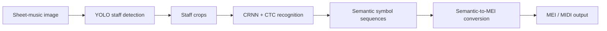
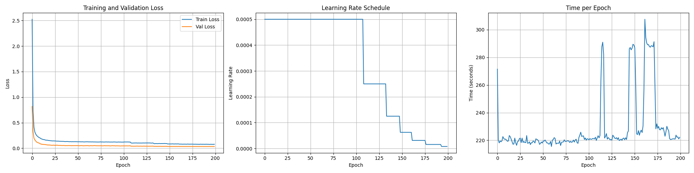

# Sheet Music Scanner — YOLO + CRNN Optical Music Recognition

An end-to-end **Optical Music Recognition (OMR)** project that detects musical staves in a score image, recognizes notation symbols, and converts the recognized sequence into symbolic music and MIDI.

This repository is a lightweight source release of the completed project, prepared primarily for **code inspection and academic portfolio presentation**.

## Pipeline



The project contains four main components:

- **Preprocessing** — splits MusicXML/MXL scores, renders score images, generates semantic labels, packages datasets, and applies augmentation.
- **Staff detection** — uses YOLO to locate and crop individual staff regions from a score image.
- **Music-symbol recognition** — uses a CRNN with bidirectional LSTMs and CTC decoding to recognize semantic or agnostic symbol sequences.
- **Postprocessing** — converts semantic predictions to MEI/MIDI and connects the recognition stages into an end-to-end inference pipeline.

## Repository structure

```text
.
├── preprocess/              # Dataset preparation and augmentation
├── yolo/                    # Staff detector training and evaluation
├── crnn/                    # CRNN training and evaluation
├── postprocess/             # Semantic-to-MEI/MIDI conversion
├── demo/                    # End-to-end inference interface
├── models/                  # Expected runtime model locations
├── assets/                  # Third-party runtime assets
├── results/                 # Representative training results
├── scripts/                 # Utility scripts
├── docs/                    # Project notes
└── requirements.txt
```

## Inference pipeline

This repository preserves the end-to-end inference pipeline used in the original project, from staff detection to symbol recognition and MIDI conversion.

It is intended primarily for **source review and portfolio presentation**, rather than as a self-contained reproduction package. Running the pipeline locally requires the original trained model weights, the matching CRNN tokenizer, and the third-party semantic converter, which are not distributed in this repository.

The command-line interface is retained to document how the original project components were connected and executed.

### Runtime asset check

```bash
python -m demo.run_pipeline --check-only
```

Expected runtime assets:

```text
models/yolo/best.pt
models/crnn/best_model.pt
models/crnn/tokenizer.json
assets/omr-3.0-SNAPSHOT.jar     # required only for MIDI conversion
```

### Example pipeline invocation

With the corresponding runtime assets available, the complete inference pipeline can be invoked with:

```bash
python -m demo.run_pipeline \
  --image path/to/score.png \
  --yolo-model models/yolo/best.pt \
  --crnn-model models/crnn/best_model.pt \
  --tokenizer models/crnn/tokenizer.json \
  --converter-jar assets/omr-3.0-SNAPSHOT.jar
```

The pipeline produces:

```text
demo_output/
├── detection/
│   ├── <score>_detected.jpg     # Staff detections overlaid on the input image
│   └── cropped_staves/          # Individual staff crops
├── semantic/                    # CRNN semantic predictions
└── midi/                        # Final MIDI output
```

Symbol recognition can also be run without the MIDI conversion stage:

```bash
python -m demo.run_pipeline \
  --image path/to/score.png \
  --yolo-model models/yolo/best.pt \
  --crnn-model models/crnn/best_model.pt \
  --tokenizer models/crnn/tokenizer.json \
  --skip-midi
```

See [`demo/README.md`](demo/README.md) for the expected runtime assets and pipeline interface.

## Training

### YOLO staff detector

The detector is trained on one class: `musical-staff-line`.

```bash
python -m yolo.yolo_train --data yolo/data.yaml --epochs 300
```

Copy `yolo/data.example.yaml` to `yolo/data.yaml` and update the dataset paths before training.

### CRNN semantic recognition

The semantic recognizer combines convolutional feature extraction, bidirectional LSTMs, and CTC loss.

```bash
python -m crnn.train_crnn_semantic \
  --data-dir path/to/primus_style_dataset \
  --epochs 200 \
  --batch-size 48
```

The retained semantic training run reached its minimum validation loss at **epoch 181 (0.034795)**.



## Preprocessing

Example preprocessing commands:

```bash
python -m preprocess.split_measure \
  --input-dir input_mxl \
  --output-dir split_xml \
  --measures-per-file 1

python -m preprocess.semantic \
  --input-dir split_xml \
  --output-dir semantic_labels

python -m preprocess.package \
  --labels semantic_labels \
  --images rendered_png \
  --output dataset

python -m preprocess.addnoise \
  --source dataset \
  --output aug_dataset \
  --noise-factor 0.3
```

Rendering MusicXML to PDF requires MuseScore. PDF rasterization may also require Poppler, depending on the platform.

## Training results

`results/` contains representative training curves and history files for the semantic and agnostic CRNN experiments.

Large checkpoints, datasets, caches, and TensorBoard logs are not included in this repository.

## Team contributions

- **Liang-Yu Cheng** — CRNN model training; preprocessing templates; YOLO evaluation; postprocessing for music generation.
- **Po-Chen Liu** — MusicXML measure splitting; music-domain consultation; music-generation evaluation.
- **Chih-Yu Hsieh** — YOLO research and implementation.
- **Yun-En Chung** — image-cropping improvements; data preprocessing; final presentation.
- **Jyun-Hung Wu** — measure-splitting and image-cropping improvements; preprocessing; CRNN evaluation.
- **Chi-Lun Chen** — automated labeling program for the CRNN dataset.
- **Shared** — dataset collection, project proposal preparation, and video presentation.

## Release scope

This repository is a lightweight source release of the completed project, prepared for **code inspection and academic portfolio presentation**.

It includes the core implementation, pipeline structure, training code, and representative training records. Datasets, trained checkpoints, matching tokenizer assets, full environment snapshots, and third-party binaries are not included.

As a result, this repository is **not intended to provide exact experimental reproduction on its own**. The included commands document how the original project components were connected and executed.

## License / third-party material

No new open-source license is added on behalf of the original project team.

Third-party datasets, libraries, pretrained models, and the semantic converter remain subject to their respective terms.
